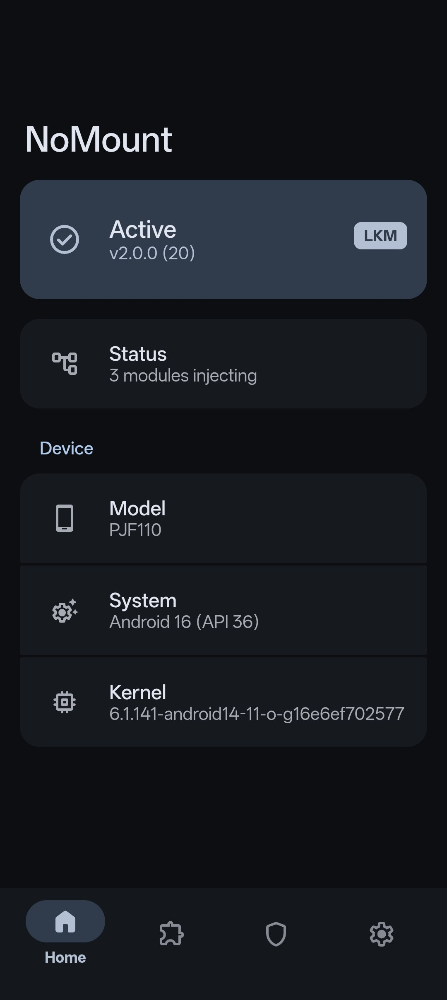
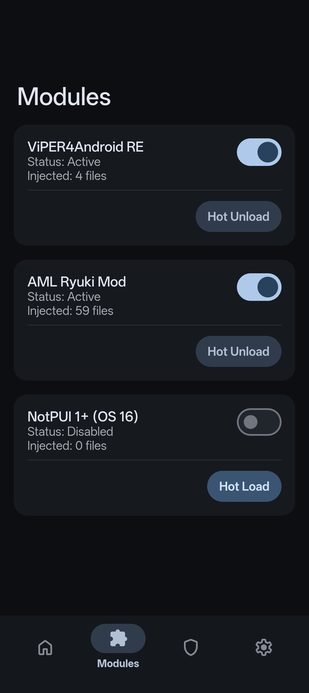
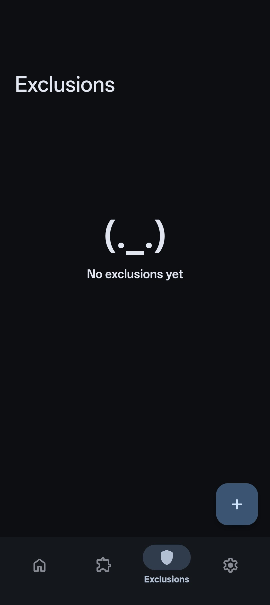
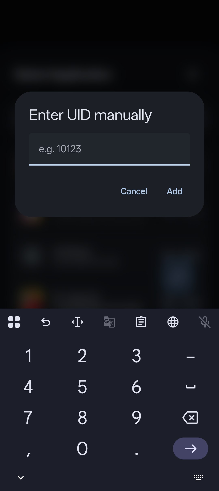
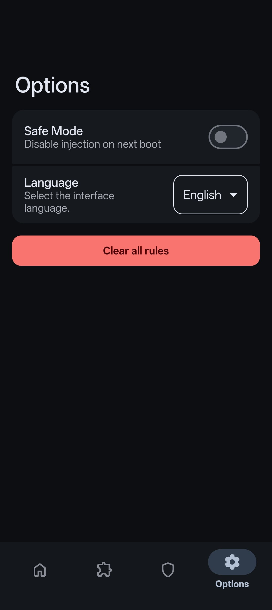
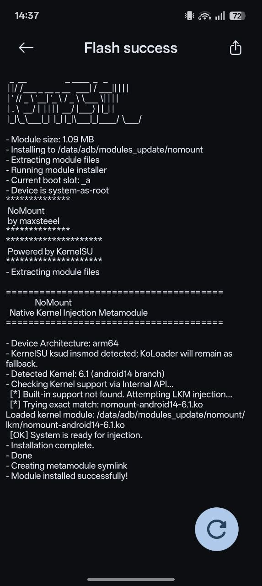

# NoMount for KernelSU-Next (Hookless)

> **WARNING:** This project operates directly at the kernel VFS layer and is intended for research and development. Proceed with caution.

**NoMount** is a VFS (Virtual File System) path redirection framework for Android kernels.

Unlike traditional mount solutions like Magic Mount or OverlayFS that rely on modifying the mount table and polluting `/proc/mounts`, NoMount operates purely in RAM. Instead of making a real mount, it intercepts path resolution and directory iteration dynamically, making file injections completely transparent to the Android system and userspace apps without generating any mounts.

<details>
<summary><strong>View Screenshots</strong></summary>
<br>
<table>
  <tr>
    <td width="50%" align="center"><a href="assets/module_1.jpg"></a></td>
    <td width="50%" align="center"><a href="assets/module_2.jpg"></a></td>
  </tr>
  <tr>
    <td align="center"><sub><b>Home Status</b></sub></td>
    <td align="center"><sub><b>Modules List</b></sub></td>
  </tr>
  <tr>
    <td width="50%" align="center"><a href="assets/module_3.jpg"></a></td>
    <td width="50%" align="center"><a href="assets/module_4.jpg"></a></td>
  </tr>
  <tr>
    <td align="center"><sub><b>Exclusions Empty</b></sub></td>
    <td align="center"><sub><b>Exclusions Active</b></sub></td>
  </tr>
  <tr>
    <td width="50%" align="center"><a href="assets/module_5.jpg"></a></td>
    <td width="50%" align="center"><a href="assets/module_6.jpg"></a></td>
  </tr>
  <tr>
    <td align="center"><sub><b>App Selector</b></sub></td>
    <td align="center"><sub><b>Manual Entry</b></sub></td>
  </tr>
  <tr>
    <td width="50%" align="center"><a href="assets/module_7.jpg"></a></td>
    <td width="50%" align="center"><a href="assets/module_8.jpg"></a></td>
  </tr>
  <tr>
    <td align="center"><sub><b>Options</b></sub></td>
    <td align="center"><sub><b>Installation</b></sub></td>
  </tr>
</table>
</details>

## How it Works

When you set up a redirection, you provide two paths: the original file the system expects to find (e.g., `/vendor/etc/audio.conf`), and your modified file located elsewhere (e.g., `/data/local/tmp/mod.conf`).

Instead of applying global hooks in-kernel that affect the whole system, NoMount specifically modifies the directory operations of the target path directly in the RAM cache. When an application requests the original file, NoMount intercepts the call and creates a fake file representation in RAM. Once the application opens this file, NoMount internally opens your real modified file in the background and links them together. From that exact moment, any read, memory mapping (`mmap`), or data operation performed by the application is forwarded to your real file. The application reads the modified content naturally, completely unaware of the redirection.

NoMount also takes control of directory iteration. This allows you to inject entirely new files into existing system directories or completely hide existing ones (known as whiteouts). When an app or a terminal command like `ls` tries to list the contents of a directory, NoMount dynamically injects the new entries or omits the hidden ones, reflecting the changes in file lists and system calls. Also NoMount includes a dedicated UID filter. Before any path interception occurs, NoMount checks the process ID of the application making the request. If the app's UID is flagged (such as a banking app or an root detector), NoMount simply steps aside and lets the kernel resolve the path normally. The isolated app will see the stock, untouched filesystem.

This approach makes NoMount highly compatible with both read-only partitions (like `erofs`) and read-write partitions (like `ext4`), because the underlying partition is never modified. In this fork the NoMount runtime is built into KernelSU-Next, and all communication between the
userspace tool and the kernel is handled over the **Linux keyring**: the client adds a key of
the custom `nomount` key type with `add_key(2)`, and the kernel applies the command while
that key type preparses the payload. This is the same transport upstream NoMount uses, and it
requires `CAP_SYS_ADMIN` in the initial user namespace, so an unprivileged app cannot
install NoMount rules. The transport completely bypasses the complications of traditional
`/dev` nodes and IOCTL commands.

## How to Use It (Metamodule)

NoMount is distributed as a **Metamodule** for KernelSU (and forks) and APatch (and forks). This means it acts as a master module that dynamically intercepts and manages the mounting process of other standard modules in your system.

The NoMount module includes a built-in **WebUI** that allows you to easily control the kernel subsystem without touching the terminal:
* **Hot Load/Unload:** Enable or disable modules on the fly without rebooting.
* **App Exclusion (UID Isolation):** Select specific apps (like banking apps or anti-cheats) from a list. The WebUI extracts their UID and isolates them, ensuring they only see the stock, untouched filesystem.
* **Global Flush:** Instantly clear all redirection rules and UID isolations.
* **Hookless Self-Test:** Run an in-kernel feature check and stream its progress.

### Do I need a custom kernel?

This fork does **not** ship kernel patches. The NoMount runtime is hosted inside
KernelSU-Next itself, so you need a KernelSU-Next build with the hookless
NoMount bridge enabled:

```text
CONFIG_KSU_KPROBES_HOOK=y
CONFIG_KSU_KPROBES_SUSFS=y
CONFIG_KSU_KPROBES_NOMOUNT=y
```

The upstream standalone kernel tree (and its LKMs) is not compatible with this
module: this fork drives the kernel through the keyring transport, but with
its own global rule model and its own payload layout.

### How to Install the NoMount Metamodule

If your kernel already has NoMount integrated, or if you plan to use the included / compiled LKM, simply download the latest module from [Releases](https://github.com/maxsteeel/nomount/releases) or the [Nightly builds (dev branch)](https://nightly.link/maxsteeel/nomount/workflows/build/dev). Flash it via KernelSU/APatch and reboot your device.

After rebooting, just install your favorite modules (like audio mods or system tweaks) in KernelSU/APatch exactly as you normally would. NoMount's Metamodule will automatically intercept them at boot and use VFS injection instead of traditional mounts.

## How to Use It (Binary)

The subsystem is controlled via the `nm` binary. The CLI uses a simple command structure.

| Command | Description |
| --- | --- |
| `nm rule add <virtual> <real>` | Inject `real` file at `virtual` path. |
| `nm rule add --whiteout <virtual>` | Hide the file/directory at `virtual` path. |
| `nm rule add --opaque <virtual> <real>` | Redirect the directory at `virtual` to `real`; the stock children of `virtual` vanish from lookups while the backend children stay listable. |
| `nm rule add --uid 10256 <virtual> <real>` | Scope the rule: only UID 10256 sees the redirect; every other UID sees the stock path. |
| `nm rule add --uid-range 10000 19999 <virtual> <real>` | Scope the rule to a UID range. |
| `nm rule add --uid-range 10000 19999 --uid-excluded 10318 <virtual> <real>` | Range scoping with a single-UID denial window inside it (~opt-in for everyone except one app). |
| `nm rule del <virtual>` | Remove a rule. A scoped rule also deletes with `nm rule del --uid 10256 <virtual>`: UID windows and deny windows are part of the rule's identity, and mismatching deletions fail with `ENOENT`. |
| `nm uid add <uid>` | Add UID to the exclusion list; isolated apps and terminals under that UID always see the stock filesystem. |
| `nm uid del <uid>` | Remove the UID from the exclusion list. |
| `nm uid list` / `nm uid list --json` | Show UIDs on the exclusion list. |
| `nm uid block_isolated [on\|off\|state]` | Toggle bulk blocking of Android isolated-process UIDs (app id `90000`-`99999`) without enumerating them. |
| `nm rule list` / `nm rule list --json` | Show active rules; scoped rules render as `[UID: a-b excl c]`, JSON adds `uid_start`, `uid_end`, `deny_start`, `deny_end` and `opaque`. |
| `nm clear all` | Flush all rules and UID entries immediately (destructive, global). |
| `nm version` | Show the kernel subsystem version. |

The legacy aliases `nm add`, `nm del`, `nm w`, `nm block`, `nm unblock`,
`nm list` and `nm v` are still accepted.

### Scoped rules in detail

Two axes compose:

* **Scope window** (`--uid`, `--uid-range`): who the rule applies to. A rule
  without one is the global fallback and covers every UID outside its deny
  window. Overlapping scope windows on the same virtual path are rejected
  with `EEXIST`.
* **Deny window** (`--uid-excluded`): a single UID carved out of the scope
  window that must *never* see the rule. A deny window is accepted only
  inside the scope window (`EINVAL` otherwise); rules with the same scope
  but different deny windows coexist in the keyring for future
  configuration, and the effective resolution is accumulated per lookup.

Deletion is exact: the same virtual, real and windows as the add. Behavior
notes verified against upstream semantics: under an opaque directory rule
`readdir` lists the backend children while lookups of non-rule children
return negative entries, so `ls` shows the injection while `stat`/`open` on
stock children correctly reports "no such file".

### Examples

**Inject a custom library:**

```bash
# The system thinks libfoo.so is in /vendor, but it loads from /data
nm rule add /vendor/lib64/soundfx/libfoo.so /data/local/tmp/my_lib.so

```

**Hide a file completely (Whiteout):**

```bash
# Make the system think this configuration file does not exist
nm rule add --whiteout /system/etc/hidden_config.xml

```

**Hide modifications from a specific app:**

```bash
# App with UID 10256 will see the untouched filesystem, bypassing detection
nm uid add 10256

```

> **Note:** Because NoMount operates entirely in RAM, manual rules or modifications created via the CLI are lost upon reboot. The metamodule handles the persistent injection of your installed modules automatically during the boot process.

## Hookless Self-Test

The module ships `bin/nomount-selftest`, also exposed from the WebUI. It checks
version probing, malformed-request rejection, canonical paths, live rule
replacement, visible inode/device identity, virtual `d_path`, directory and
symlink redirects, system-directory injection, UID isolation, synthetic
ancestor cleanup, whiteouts, rule listing, and repeated add/delete lifecycle
handling — plus, on a v16 keyring, the ABI-16 surfaces: the UID exclusion
list roundtrip, UID-scoped rules staying invisible to out-of-scope lookups,
deny-window rules making their way into the JSON render with
`uid_start`/`uid_end`/`deny_start`/`deny_end`, exact-tuple deletion of
scoped rules, and opaque directory semantics. The destructive global `clear`
command is deliberately excluded.
The WebUI streams each test stage and its result live. The full log is written
to:

```text
/data/adb/nomount/selftest.log
```

## Special Thanks

* **[Kasumi](https://github.com/Anatdx/Kasumi)**: Inspiration for this project.
* **[ZQZCC](https://github.com/ZQZCC)**: WebUI MD3E-style design.
* **[backslashxx](https://github.com/backslashxx)**: Code optimization.
* **[KernelSU](https://github.com/tiann/KernelSU)**: Root solution.
* **[KernelSU-Next](https://github.com/KernelSU-Next/KernelSU-Next)**: Hookless integration host.
* **All testers and contributors**: Thanks for testing this project and helping to make it stable.

## License

- All parts of this fork are [GPL-3](https://www.gnu.org/licenses/gpl-3.0.html)

Upstream NoMount is licensed [GPL-3](https://www.gnu.org/licenses/gpl-3.0.html)
as well; the upstream `kernel/` directory was GPL-2 but is not part of this fork.

## Disclaimer

**NoMount** is a kernel modification tool intended for research and development. Modifying kernel behavior carries inherent risks. The developers are not responsible for bricked devices, data loss, or thermonuclear war.
